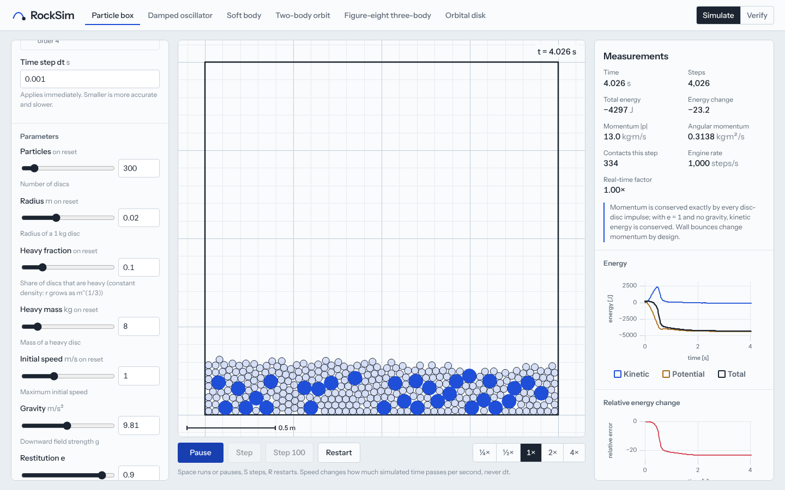
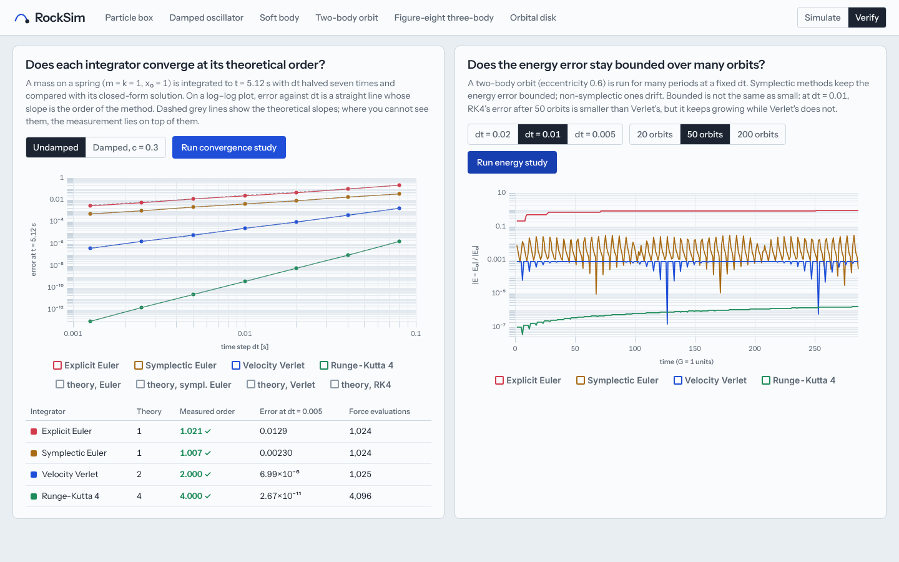
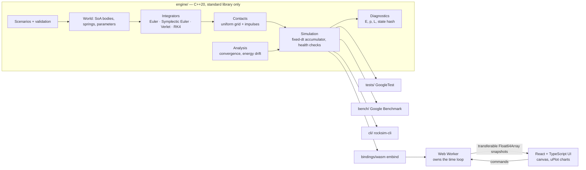

# RockSim

A 2D physics engine written in C++20 and compiled to WebAssembly. It runs particle collisions, springs and Newtonian gravity in the browser, and checks its own numerical behaviour against closed-form solutions and conservation laws while it runs.



RockSim began as **ROCsim**, a CS3307 group project at Western University (Fall 2025). This repository is a rebuild of that project; [what came from the original and what changed](#project-history-and-credits) is set out below.

## What it does

| Scenario | Physics | Checked against |
|---|---|---|
| Particle box | Discs in a box; uniform-grid broad phase; mass-weighted impulses with one coefficient of restitution | Brute-force pair search (exact equality); closed-form 1-D collision; momentum and kinetic-energy conservation |
| Damped oscillator | Mass on a damped linear spring | Closed-form solution of m x″ + c x′ + k x = 0, drawn live beside the numerical one |
| Soft body | Lattice of masses with structural and shear springs, dropped into a box | Qualitative; energy may only decrease, and any rise trips the instability detector |
| Two-body orbit | Newtonian gravity in the centre-of-mass frame | Kepler's third law; energy, momentum and angular momentum |
| Figure-eight three-body | Chenciner–Montgomery periodic orbit | Returns to its initial state after T = 6.32591398 |
| Orbital disk | O(N²) direct-sum gravity with Plummer softening | Qualitative; momentum conserved to round-off |

Every scenario runs under any of four integrators: **explicit Euler, symplectic Euler, velocity Verlet and RK4**. You can switch integrator and time step while it runs and watch what happens to the error.



## Measured results

All numbers below come from the commands shown and are reproduced by the test suite. Machine and method are in [docs/validation.md](docs/validation.md).

**Convergence order** (`rocksim-cli convergence`; oscillator m = k = 1, error at t = 5.12 against the exact solution, dt from 0.08 to 0.00125):

| Integrator | Theory | Measured, undamped | Measured, damped (c = 0.3) | Error at dt = 0.005 |
|---|---|---|---|---|
| Explicit Euler | 1 | 1.021 | 1.023 | 1.3 × 10⁻² |
| Symplectic Euler | 1 | 1.007 | 1.002 | 2.3 × 10⁻³ |
| Velocity Verlet | 2 | 2.000 | 2.000 | 7.0 × 10⁻⁶ |
| RK4 | 4 | 4.000 | 4.004 | 2.7 × 10⁻¹¹ |

**Long-run energy error** (`rocksim-cli drift --orbits 200`; Kepler orbit, e = 0.6, dt = 0.01): Verlet's error stays bounded at 8.9 × 10⁻⁴ over 200 orbits. RK4's is smaller but grows steadily, from 1.8 × 10⁻⁶ after 50 orbits to 6.9 × 10⁻⁶ after 200. Explicit Euler's orbit gains so much energy that it nearly escapes.

**Reproducibility:** after 3,000 steps, all six scenarios give bit-identical states (same 64-bit hash) on x86-64 Linux (GCC 13), ARM64 Linux (GCC 11) and in WebAssembly (Emscripten 3.1.6). All six were checked in Node; a browser test checks one in Chromium. [Why that holds, and what it took](docs/physics.md#reproducibility).

**Tests:** 58 GoogleTest cases (clean under AddressSanitizer and UndefinedBehaviorSanitizer) and 5 Playwright browser tests. The browser tests run the real WebAssembly engine.

## Quick start

Requirements: CMake ≥ 3.20, a C++20 compiler, Node.js ≥ 18 and, for the web app, Emscripten. Tested with GCC 11 and 13 and with Clang 15 (via Emscripten); recent Apple Clang should work but has not been tested yet. On macOS: `brew install cmake node emscripten`.

```bash
# Native engine, tests and CLI
cmake --preset release
cmake --build --preset release
ctest --preset release                      # 58 tests

./build/release/cli/rocksim-cli list        # scenarios and their parameters
./build/release/cli/rocksim-cli convergence # integrator orders
./build/release/cli/rocksim-cli run kepler --integrator rk4 --time 20 --out kepler.csv

# Web app: compile the engine to WebAssembly, then run the UI
emcmake cmake -S . -B build/wasm -DCMAKE_BUILD_TYPE=Release
cmake --build build/wasm                    # writes web/src/wasm/rocksim.mjs
cd web                                      # (a prebuilt rocksim.mjs is included, so this step is optional)
npm install
npm run dev                                 # http://localhost:5173
```

More options:

```bash
cmake --preset debug && cmake --build --preset debug && ctest --preset debug   # ASan + UBSan
cmake --preset bench && cmake --build --preset bench && ./build/bench/bench/rocksim_bench
cd web && npm run build && npx playwright install chromium && npm run test:e2e   # browser tests
```

## Architecture



The engine knows nothing about rendering, Qt, browsers or Emscripten. The same sources are compiled natively, where the tests, benchmarks and CLI prove correctness, and to WebAssembly, where the demo runs. In the browser, a Web Worker owns the simulation and its fixed-step loop, so a slow step never blocks the interface. More detail in [docs/architecture.md](docs/architecture.md).

## Engineering decisions

- **Fixed time step, decoupled from rendering.** The original app advanced physics once per Qt timer tick, so its speed slider changed the physics. Here, simulated time accumulates and is consumed in whole steps of dt. Playback speed changes how much simulated time passes per second, never dt.
- **Exact broad phase.** Grid cells are at least 2 r_max wide, every body drives its own 3×3 neighbourhood search, and tests require the result to equal brute force over random scenes. Both defects found in the original were of this kind ([audit](docs/audit.md)).
- **One restitution model, momentum-conserving by construction.** J = −(1 + e) v_n / (1/m_a + 1/m_b), applied as −J/m_a and +J/m_b.
- **Deterministic across platforms.** State paths use only correctly rounded IEEE 754 operations: no `hypot`, `sin`, `cos` or `cbrt` from libm. The engine is compiled with `-ffp-contract=off`, and initial conditions use a PCG32 generator with hand-written distributions.
- **Verlet stays second order with damping.** A test caught that the textbook kick–drift–kick loses an order when forces depend on velocity. A predictor–corrector pass fixes it and costs one extra force evaluation per step ([details](docs/physics.md#velocity-verlet-with-damping)).
- **Failure is explicit.** Invalid parameters come back as specific messages. A non-finite state, or an energy gain in a system that cannot gain energy, stops the run and says why.
- **Dependencies are minimal.** The engine needs only the standard library. GoogleTest and Google Benchmark are build-time only, found locally or fetched at pinned versions. The web app uses React, uPlot (fast streaming charts) and a self-hosted font.

## Documentation

- [docs/physics.md](docs/physics.md): models, equations, integrators, contacts, units, reproducibility, limitations
- [docs/validation.md](docs/validation.md): every test, what it establishes and what it does not, with measured results
- [docs/benchmarks.md](docs/benchmarks.md): method, machine and results
- [docs/architecture.md](docs/architecture.md): components, data flow and the worker protocol
- [docs/audit.md](docs/audit.md): the audit of the original code, with findings E1–E8 and how each was resolved

## Limitations

- 2D only; discs and point masses. No rotation, friction or rigid-body constraints.
- Contacts are detected at discrete steps, so a body moving more than its radius per step can tunnel. Simultaneous contacts are resolved by sequential pairwise impulses, which is an approximation.
- The convergence orders hold for smooth forces. Contact events are applied after each step and reduce the effective order.
- N-body uses O(N²) direct summation, which is practical up to a few hundred bodies at interactive rates.
- The soft-body and orbital-disk scenarios are qualitative demonstrations, not validated models.
- The original HIP/ROCm GPU kernel is preserved in `legacy/` but is not part of the new engine. It cannot run on macOS or in a browser.

## Roadmap

Implemented: everything above. Possible next steps, none started:

- Barnes–Hut tree for N-body (O(N log N)), validated against direct summation
- Continuous collision detection for fast bodies
- WebGL2 instanced rendering for >10⁴ bodies (profile first: at current sizes the engine, not drawing, dominates)
- A GPU compute backend behind the same `Integrator` interface (WebGPU in the browser)

## Project history and credits

**ROCsim (Fall 2025)**, the original CS3307 group project at Western University:

- Team 1, physics and GPU compute: **Jiwon Lee**, **Jacob Lee**
- Team 2, visualization and UI: **Eric Jean**, **Maharshii Patel**

The original delivered a Qt 6 desktop app with a particle model, a uniform-grid collision broad phase, an impulse collision response, a HIP/ROCm GPU kernel for the particle update, JSON save and load, and the UI concepts this version keeps: a parameter panel, a scene selector, live stats and save/load. Its source, course deliverables and original README are preserved unchanged in [`legacy/`](legacy/) and [`docs/course/`](docs/course/).

**RockSim (2026 rebuild)**, by Jiwon Lee, with the original team's agreement:

- a new Qt-free C++20 engine, with the original particle model rebuilt and its defects fixed
- four integrators and the spring and N-body models
- the validation suite, CLI, benchmarks, cross-platform reproducibility, the WebAssembly bindings and the React interface

## License

No license has been chosen yet. Until one is added, all rights are reserved by the authors listed above.
