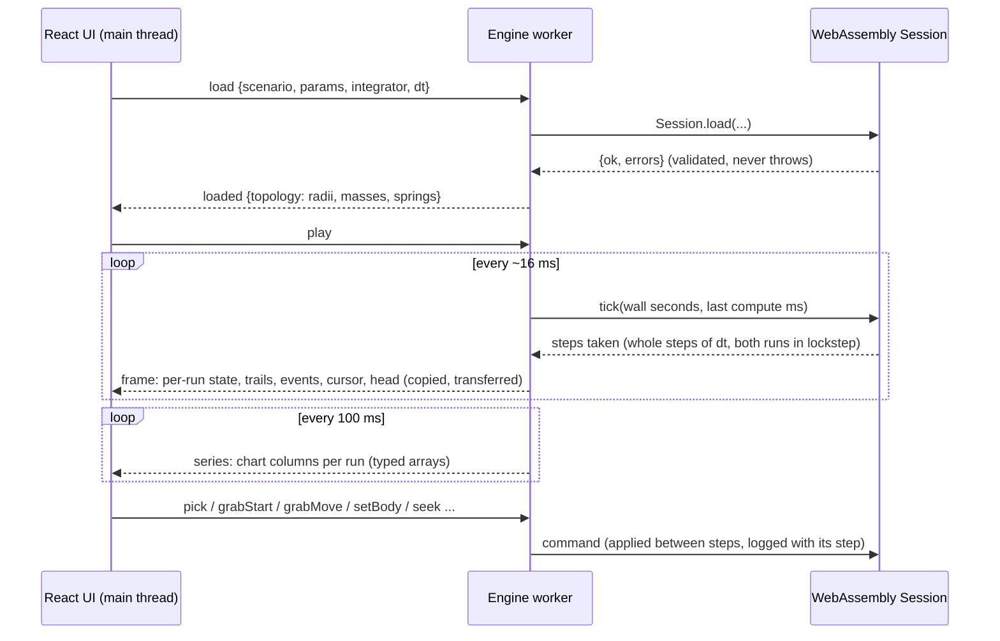

# Architecture

## Layout

```
engine/            C++20 library, standard library only (no Qt, no Emscripten)
  include/rocksim/   public headers: world, contacts, integrators, simulation, session, scenarios, analysis, analytic, rng
  src/               implementation
tests/             GoogleTest suite (84 tests)
bench/             Google Benchmark
cli/               rocksim-cli: list, run, convergence, drift, hash
bindings/wasm/     embind layer, the only code that knows about JavaScript
web/               React + TypeScript + Vite UI; the engine runs in a Web Worker
docs/              physics, validation, benchmarks, audit, course deliverables
legacy/            the original Qt application, unchanged, plus the audit harness
```

## Data flow



The worker marshals only. Seeks, grab moves, body drags and live edits are coalesced so the newest of each is applied once per tick. `pick` is answered at once, not on the next tick. The UI draws and collects input; every decision about time, history and branching is made in C++.

## Components and their contracts

**`World`** (`world.hpp`) holds plain data: bodies stored as a structure of arrays, springs, and global parameters. `computeAccelerations` evaluates the smooth forces at any phase-space point, so multi-stage integrators can call it at trial states. `validateWorld` returns messages and never throws.

**`Integrator`** (`integrators.hpp`) advances the smooth dynamics by dt. It allocates nothing after the first step. It caches the last acceleration for Verlet, and that cache must be invalidated after any outside change to state or parameters; `Simulation` does this.

**Contacts** (`contacts.hpp`): `UniformGrid::findOverlaps` returns exactly the brute-force pair set, sorted. `resolveContacts` applies positional projection and impulses. The two are separate so the broad phase can be tested and benchmarked on its own.

**`Simulation`** (`simulation.hpp`) owns a world and runs the fixed-dt accumulator, contacts, health checks and diagnostics. `Simulation::create` validates its inputs; an invalid simulation is inert. Live parameter edits go through `paramsChanged()`, which re-validates and rolls back on failure.

**`Grab`** (`world.hpp`) is the user's hand: a critically damped pull of one body toward a target, `a += omega^2 (target - x) - 2 omega v` with `omega = min(30, 0.2 / dt)`. It is added inside `computeAccelerations`, so RK4's trial states see it, and it uses only arithmetic and `sqrt`. A grab adds energy, which the health check would otherwise call numerical instability, so the energy-growth check is suspended while a grab is held and the baseline is reset on release; the non-finite check stays on. Without a grab, stepping is bit-identical to before (the golden hashes did not change).

**`Session`** (`session.hpp`) owns everything the worker and the old `History` class did, free of Emscripten:

- *Time loop:* `tick(wallSeconds, lastComputeMs)` holds the accumulator, the adaptive step budget, the backlog cap and steps per second.
- *Runs and the event log:* a run is a `Simulation` plus an append-only log of step-stamped events (`GrabStart/Move/End`, `SetParam`, `SetDt`, `SetIntegrator`, `SetBody`). Commands are applied between steps; rejected ones are not logged; repeated moves within one step collapse to the newest.
- *Keyframes and seeking:* `Simulation::capture()/restore()` snapshot everything that can change after load (positions, velocities, parameters, dt, integrator and its Verlet cache, time, accumulator, baseline, status). A keyframe is taken every 250 steps, right after a step and before that boundary's events, under a 64 MB budget shared by all runs; the oldest go first and older events go with them. Seeking restores the nearest keyframe and replays steps and events, which reproduces the recorded state bit for bit.
- *Branching:* a command made behind the head copies the run into B and applies it there, so A's future stays. A and B advance in lockstep; a third branch replaces B.
- *Samples, trails, picking:* the chart history (4000 points, resolution halves when full) with per-run energies, the oscillator reference and A/B divergence; trails at a fixed step stride, cleared on seek; `pick` with a tolerance in world units.

**Scenarios** (`scenarios.hpp`) form a catalogue of parameter specifications: range, unit, integer-only, and whether a parameter can change while running. The CLI and the web UI both use it, so validation rules live in one place.

**Analysis** (`analysis.hpp`) runs the convergence and energy-drift studies. The CLI, the tests and the browser's Verify view all run the same code.

**WebAssembly bindings** (`bindings/wasm/bindings.cpp`) expose bulk arrays as typed-array views into WebAssembly memory. The worker copies them at once, because growing memory invalidates the views, and transfers the copies to the UI thread at zero cost. Errors cross the boundary as `{ok, errors}` objects; exceptions are disabled.

**Engine worker** (`web/src/engine.worker.ts`) owns the WebAssembly `Session` and marshals messages; the time loop itself lives in `Session::tick`, whose step budget adapts to measured step cost and stays under about 10 ms. When the engine can't keep up, simulated time runs slower instead of building a backlog.

**UI** (`web/src`):

- `wm/` is a small window manager: `Desktop`, `Window` (drag, corner resize, raise, collapse, close), `useWindows` (layout saved to versioned `localStorage`, re-clamped when the desktop shrinks) and a bottom `MenuBar` (Scene, Run, Window, Verify, Help) with the ARIA menu keyboard model. Below 760 px the windows stack full width with no dragging.
- `Viewport` draws on a canvas every animation frame from the latest frame: dot grid, scale bar, strain-coloured springs, dotted engine-recorded trails, the oscillator's exact ring. Pointer events: a body hit (asked of the engine via `pick`) is grabbed while running or moved while paused, empty space pans, wheel and pinch zoom. The selected body's velocity arrow tip and the gravity arrow are draggable handles.
- `Timeline` is the transport and a tape strip in simulated time: drag to seek, event marks, A and B tracks, the unreachable range hatched, `LIVE` or `REPLAY`. Charts show the cursor and event marks, and clicking one seeks.
- React re-renders readouts and charts (uPlot) at 10 Hz. `SetupPanel` (the Parameters window) validates every field inline before anything reaches the engine and lets any number be scrubbed by dragging. Colours come from CSS custom properties through `theme.ts`.

## Decisions and trade-offs

| Decision | Alternative | Why |
|---|---|---|
| C++ engine compiled to WebAssembly, with a React UI | SDL2 + Dear ImGui native app | A reviewer can use the real engine from a link, and the build forces the engine to stay UI-free. Cost: two toolchains. |
| Single-threaded WebAssembly in a worker | WebAssembly threads | Threads need cross-origin isolation (COOP/COEP headers), which static hosts such as GitHub Pages cannot set. One worker already keeps the UI responsive. |
| Time travel by keyframes plus an event log | Storing every step | A 64 MB budget covers a long run at 250-step spacing, replay is deterministic by construction, and the log is the honest record of what the user did. |
| Window manager with overlapping windows | Fixed three-column layout | The retro workstation look and letting the student arrange instruments. Kept basic: no docking, no named layouts. |
| Canvas 2D | WebGL2 | Engine stepping dominates at the supported body counts, so WebGL would add complexity without a measured need. |
| uPlot | Recharts and similar | Streaming time series at 10 Hz with thousands of points; uPlot draws on canvas and is about 50 KB. |
| `double` everywhere | `float` (as in the original) | Validation down to 10⁻¹¹ requires it; memory is not the constraint at these sizes. |
| No exceptions across the WebAssembly boundary | Exceptions | Smaller, faster binary; every error is a value the UI can display. |
| `SINGLE_FILE` WebAssembly (embedded in the JS module) | A separate `.wasm` file | No path resolution issues in workers or bundlers, for about 33% more size on the wasm part (about 240 KB total). |
